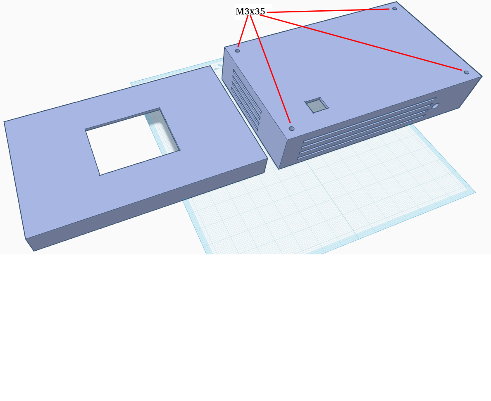
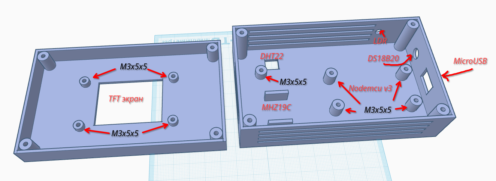
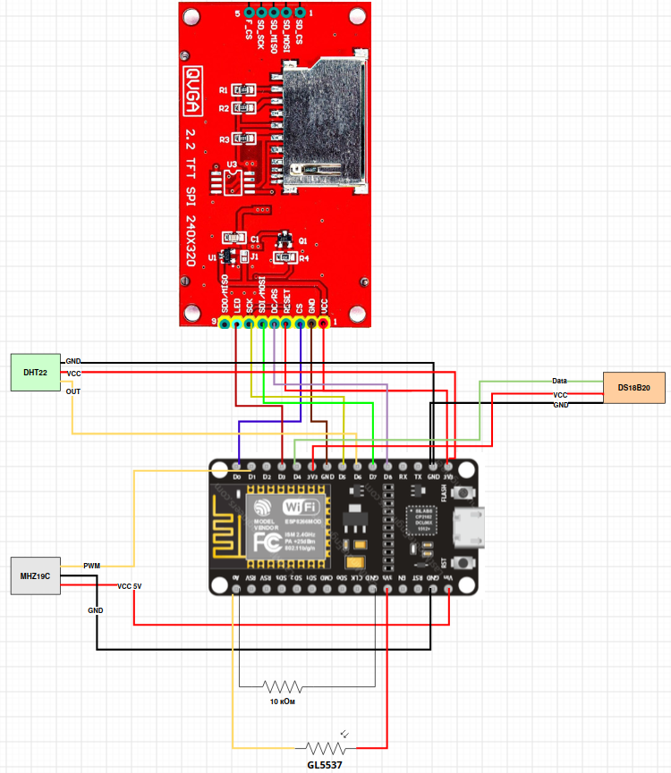
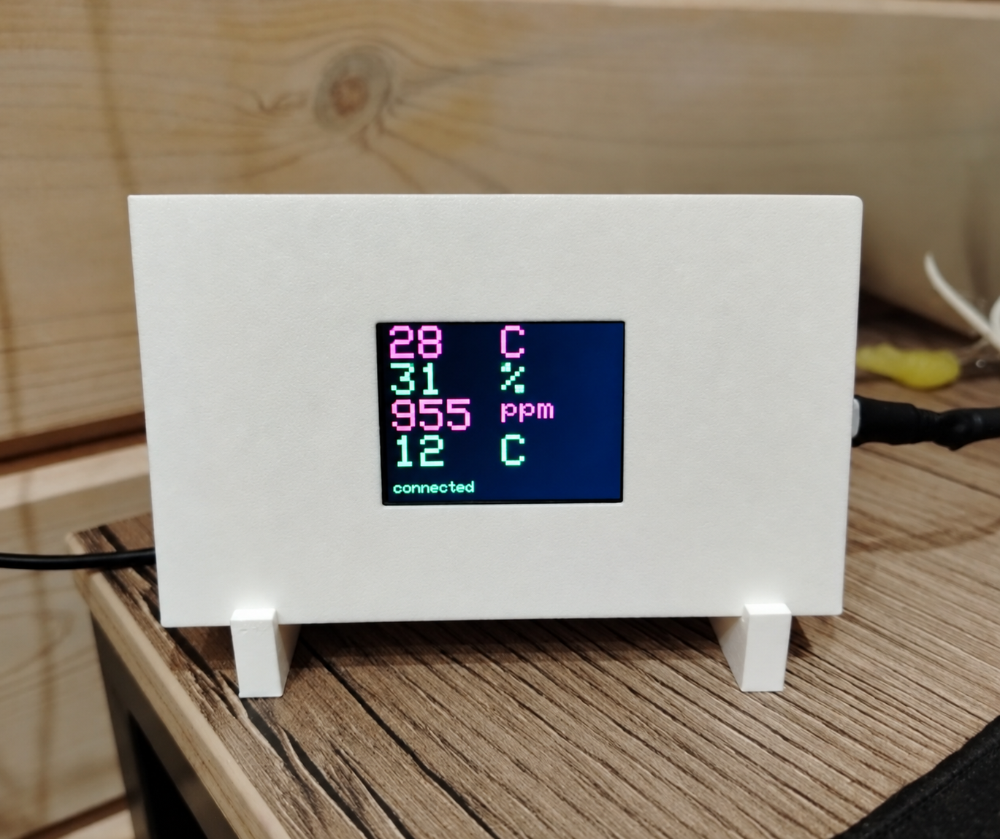
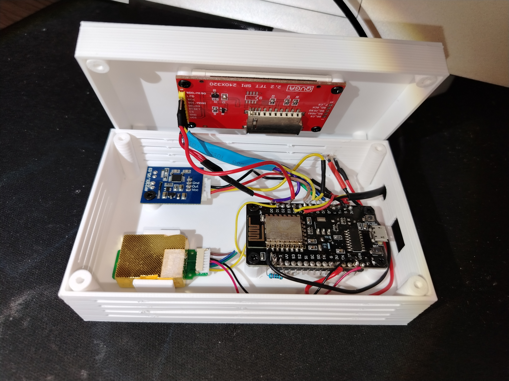

# Описание

В данном репозитории представлена программная начинка, схема подключения и 3D-модели корпуса устройства
для анализа воздуха в жилом помещении и за его пределами.

Каждый сможет самостоятельно собрать для себя такое устройство или модифицировать его под собственные
нужды, имея паяльник и 3D-принтер.

## Используемая аппаратная начинка

* Основа - Nodemcu v3
* Экран  - TFT LCD 2.2 SPI ILI9225
* Датчик температуры и влажности - DHT22
* Датчик внешней температуры - DS18B20
* Датчик содержания CO2 - MHZ19C
* Фоторезистор для адаптации подсветки экрана - GL5537

## Функциональные возможности

Измеряет, отображает на экране, выдаёт через HTTP-сервер следующие данные:
* Температура (в градусах цельсия)
* Относительная влажность воздуха
* Температура внешняя (c DS18B20, можно, например, вынести датчик на улицу)
* Содержание углекислого газа (CO2)

Подключается к указанной в прошивке Wi‑Fi сети и поднимает HTTP-сервер на порту 80.

С этого сервера данные в формате JSON можно забирать для дальнейшей обработки.

Адаптирует подсветку экрана в зависимости от внешнего освещения.

Меняет цвет шрифта (с зеленого на красный), если значения параметров выходят за установленную норму.

Подключается к питанию через Micro-USB.

## Корпус

Представлен в виде трёх частей:
* передняя панель
* задняя панель
* подставка

Имеет множественную перфорацию для отвода тепла и воздухообмена.





STL-файлы вы можете взять в каталоге `./3d`

## Схема подключения



# Для любителей графиков

## Node exporter для prometheus

Для работы экспортёра требуется python3.

Установка зависимостей (на пимере Ubuntu/Debian)

```sudo apt install python3-prometheus-client python3-requests```

* Пример запуска node-exporter: `python3 ./exporter.py http://192.168.1.5 9101`
* Пример конфига для prometheus - `./prometheus-node-exporter/prometheus.yaml`

# Сборка и прошивка

Сборка и прошивка осуществляется с помощью PlatformIO

## Подготовка секретов

Необходимо создать файл `src/secrets.inc` и добавить туда следующее содержимое:

```C
#define SECRETS_WIFI_SSID "MyWiFi"
#define SECRETS_WIFI_PASS "password"
```

где `MyWiFi` и `password` имя сети и пароль соответственно.

## Конфигурация датчика MHZ19C

Т.к иеются датчики с разным диапазоном измерений, то верхнюю границу необходимо указать в файле
`src/mhz19.inc`. Стандартное значение - 5000.

# Прошивка

* Без отладочных сообщений: `pio run -t upload`

* С отладочными сообщениями: `PLATFORMIO_BUILD_FLAGS="-D BUILD_CONF__DEBUG_MODE" pio run -t upload`

# Фото



